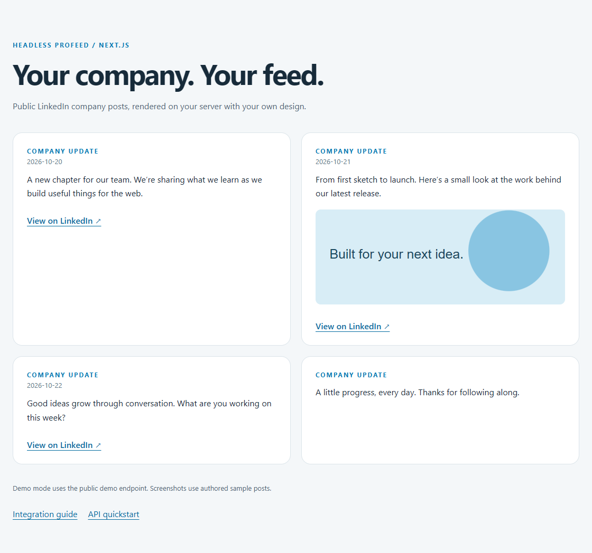
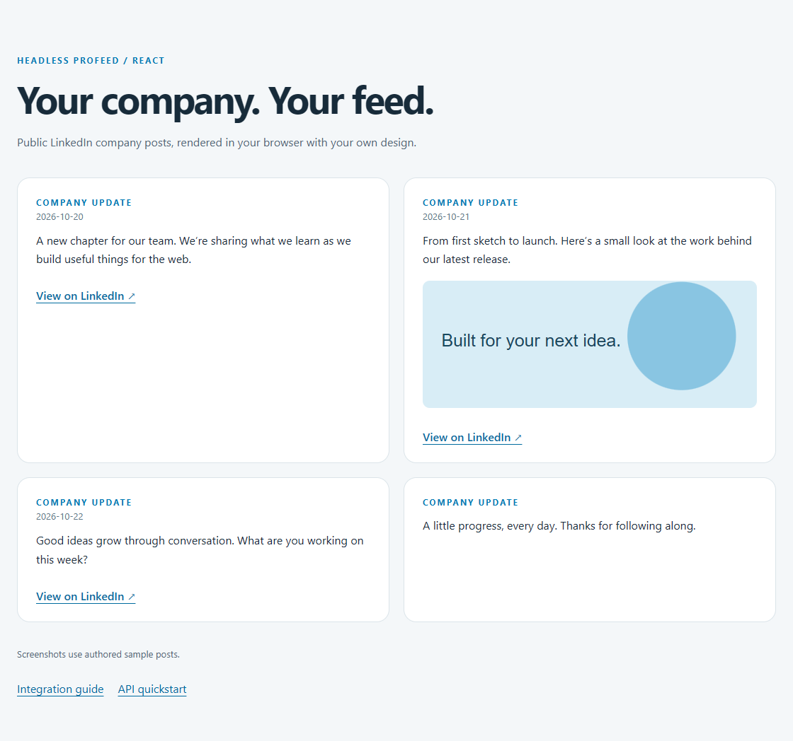
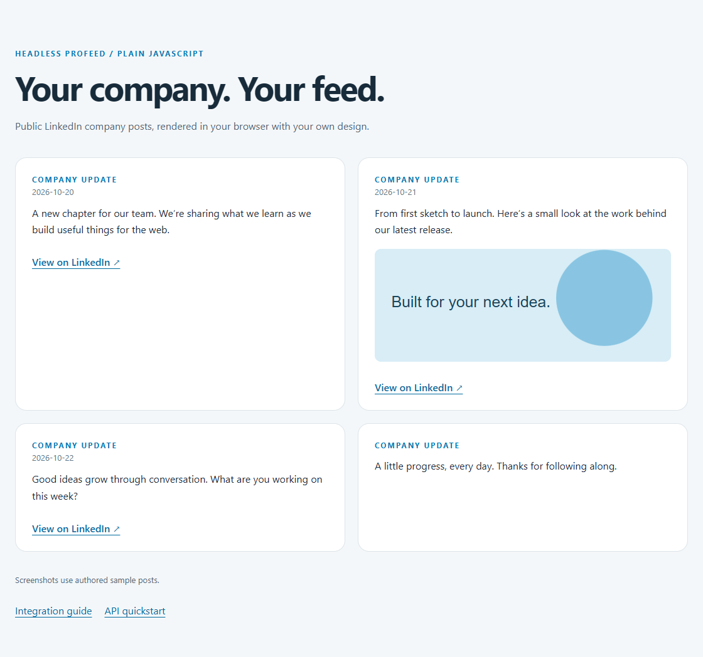

# Headless Profeed examples

Complete, independently runnable LinkedIn company feed examples by **Accomplice AB**. Choose server rendering, browser rendering or a static build. Headless Profeed is an independent third-party REST JSON service, not LinkedIn's official API. Connect public company/showcase pages you own or are authorized to use; personal profiles and private content are unsupported.

| Example                     | Rendering                                | Authentication          | Tested versions           | Guide                                                                             |
| --------------------------- | ---------------------------------------- | ----------------------- | ------------------------- | --------------------------------------------------------------------------------- |
| [Next.js](nextjs)           | App Router server component, per request | Secret server key       | Next 16.4.3, React 19.3.1 | [Next.js guide](https://headless.profeedwp.com/guides/nextjs-linkedin-feed)       |
| [React](react)              | Browser component                        | Publishable browser key | React 19.3.1, Vite 8.3.5  | [React guide](https://headless.profeedwp.com/guides/react-linkedin-feed)          |
| [Plain JavaScript](vanilla) | Browser, DOM APIs                        | Publishable browser key | Vite 8.3.5                | [Posts as JSON](https://headless.profeedwp.com/guides/linkedin-company-posts-api) |
| [Astro](astro)              | Static HTML at build time                | Secret build-time key   | Astro 7.4.2               | [Astro guide](https://headless.profeedwp.com/guides/astro-linkedin-feed)          |

## Run an example

Install **Node 22.23.4 or later**. Each directory has its own package manifest, lockfile and `.env.example`; no workspace package linking is required.

```sh
git clone https://github.com/ProFeedWP/headless-profeed-examples.git
cd headless-profeed-examples/react
npm ci
cp .env.example .env
npm run dev
```

On PowerShell use `Copy-Item .env.example .env`. Next.js uses `.env.local` instead. Open the exact URL printed by the dev server. Run `npm test` for unit checks and `npm run build` for production. Next.js production uses `npm start`; the other examples use `npm run preview`.

The template explicitly selects **demo** mode, which calls the credential-free public `/demo` endpoint. To use your own feed, set the mode to **customer**, supply your feed ID and the correct key, then restart/rebuild. Missing customer credentials show a useful error; they do not switch to demo.

## Authentication and API behavior

- `hp_sk_` secret keys belong on a server or in a static build's CI secrets. They must never appear in browser-prefixed variables, rendered HTML or bundles.
- `hp_pk_` publishable keys belong in browser integrations. Scope them to selected feeds and exact origins, including scheme, host and port. Add both local and production origins. These keys are visible to visitors, and origin restrictions do not make the public content confidential.
- Customer requests require an active subscription and valid key. Do not put keys in URLs. The browser supplies `Origin`; do not override it or send cookies.
- **202** means first collection is pending, even though `response.ok` is true. Wait for `Retry-After`. **200 with an empty posts array** means an empty completed feed.
- **401** means invalid credentials; **403** can mean subscription, feed scope or origin denied; **429** means wait for the retry interval; **503** means temporarily unavailable. Browser retries wait for the advertised interval and requests are aborted on cleanup.
- The API serves cached posts. Self-service paid feeds refresh on a three-hour schedule; Enterprise intervals are agreed separately. Repeated reads do not force collection. Next.js starts with `no-store`; additional application caching adds another freshness delay. Astro content only changes after a successful rebuild/deployment.

Each implementation renders up to four posts, treats text as text, validates links, and tolerates missing dates, media or post URLs. It distinguishes pending collection, empty data, stale data and failures. Styling is deliberately small and editable.

## Result previews

These screenshots come from the production examples using **authored sample posts and an authored SVG**. They are not customer data or a promise of particular LinkedIn content. [Provenance and checksums](screenshots/provenance.json) records the tested tool versions. The screenshot, source and website snapshot are pinned together by the website's imported repository commit.

### Next.js



### React



### Plain JavaScript



### Astro


## Reproduce the checks

From the root, install the test tooling and each example you want to check:

```sh
npm ci
npm --prefix react ci
npx playwright install chromium
npm test
npm run check -- react
```

Omit `-- react` to check all four (install their dependencies first). `PLAYWRIGHT_CHANNEL=chrome` may select an installed Chrome locally; CI installs Chromium. The runner starts a local fixture API, runs unit checks, builds production code and inspects real browser rendering at 320, 390, 768 and 1440px. It checks populated/empty feeds, optional fields, pending collection, credential/origin errors, rate limits, temporary failures, text/link safety and server-key canaries. Astro's pending and failure fixtures must fail its build. No customer credentials or network API access are needed. CI runs a matrix with independent clean installs.

The optional **`npm run smoke:demo`** command separately calls the real public demo. It can fail if collection is pending or the public allowance is exhausted; honor its retry interval. CI deliberately uses fixtures rather than depending on demo availability.

## Documentation and contributing

[All guides](https://headless.profeedwp.com/guides) · [API quickstart](https://headless.profeedwp.com/docs) · [Authentication](https://headless.profeedwp.com/docs/authentication) · [Response fields](https://headless.profeedwp.com/docs/responses) · [OpenAPI specification](https://headless.profeedwp.com/openapi.json)

See [CONTRIBUTING.md](CONTRIBUTING.md) and [AGENTS.md](AGENTS.md). Code, authored fixtures and screenshots are MIT licensed, copyright 2026 Accomplice AB. No third-party media is included.
